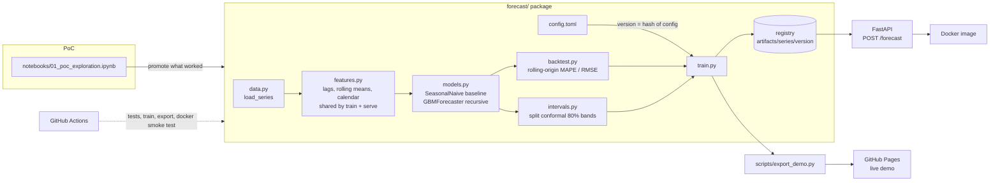

# Forecast: PoC → Production

[](https://github.com/hrutishaa/forecast-poc-to-prod/actions/workflows/ci.yml)
[](LICENSE)

**🔴 Live demo: https://hrutishaa.github.io/forecast-poc-to-prod/** (pick a series, drag the horizon, compare baseline vs model against actuals, with an 80% prediction-interval band)

Most forecasting projects stop at a notebook with a nice chart. This repo goes further: it takes that notebook to something you can deploy, with
**a baseline you have to beat → leak-free features → rolling backtests → prediction intervals → versioned config → model registry → FastAPI `/forecast` → Docker → CI**.

| Series (monthly, 96 pts) | Seasonal-naive MAPE | GBM + lags MAPE | Error reduction |
|---|---|---|---|
| retail_sales | 4.61% | **1.34%** | −71% |
| ecommerce_orders | 13.16% | **8.73%** | −34% |
| energy_demand | 1.95% | **1.94%** | ≈0%: on a stable seasonal series the baseline is already hard to beat, and the backtest shows that honestly |

*3-fold rolling-origin backtest, 12-month horizon. These numbers are recomputed in CI.*

### Prediction intervals (v0.2)

A single number is not enough for planning, so every forecast now comes with an **80% prediction interval** built with
**split conformal calibration** (`forecast/intervals.py`): re-fit the model at 12 past cut-offs, measure its real relative
error at each step ahead, and use the finite-sample conformal quantile of those errors as the band's half-width. No extra
model and no normal-distribution assumption, and the band widens the further out you forecast.

Honest check on the demo's 12-month holdout (band calibrated on the training window only):

| Series | GBM band coverage (target 80%) | Avg. band width |
|---|---|---|
| retail_sales | 12/12 = 100% | ±7.2% |
| energy_demand | 9/12 = 75% | ±4.6% |
| ecommerce_orders | 4/12 = 33% | ±9.4% |

The e-commerce miss is a real finding, not a bug: on a fast, exponentially growing series the recursive GBM's errors on
unseen months are bigger than its past errors, so the band is too narrow. That is exactly what intervals plus a coverage
check are for, and it is the motivation for the drift-monitoring item on the roadmap.

## Architecture



### Design decisions
- **Baseline first.** Seasonal naive gets the same backtest as the model. If the model doesn't beat it, the model doesn't ship (`beats_baseline` is saved in the model's metadata).
- **No train/serve skew.** Training and recursive inference both call the same `make_features`, and a unit test checks that no feature can see the value it's predicting.
- **Trees can't extrapolate trends,** so the GBM learns *first differences* and the predictions are added back up to levels.
- **Intervals from real errors.** Bands come from out-of-sample errors per step ahead (split conformal), are stored with the model in the registry, and refuse to claim a level the calibration data can't support (e.g. 95% from 10 errors raises an error).
- **Versioning by config hash.** `gbm_lags-d7811b8175` means "this exact config". Retraining with the same config overwrites the same version, and any config change creates a new version alongside the old one, which makes rollback easy.
- **Free, instant demo.** The static page reads results that the pipeline precomputed (`docs/data.json`), so there are no servers or keys to keep running.

## Quickstart

```bash
git clone https://github.com/hrutishaa/forecast-poc-to-prod && cd forecast-poc-to-prod
python -m venv .venv && source .venv/bin/activate      # Windows: .venv\Scripts\activate
pip install -e ".[dev]"
pytest                                                  # 29 tests
python -m forecast.train                                # backtest + register all series
uvicorn forecast.api:app --reload                       # http://localhost:8000/docs
```

```bash
curl -X POST localhost:8000/forecast -H 'Content-Type: application/json' \
  -d '{"series": "retail_sales", "horizon": 12}'
```

With Docker:

```bash
docker build -t forecast . && docker run -p 8000:8000 forecast
```

## API

| Method | Path | Description |
|---|---|---|
| GET | `/health` | liveness + app version |
| GET | `/series` | available series |
| POST | `/forecast` | `{"series": str, "horizon": 1..24}` → dated forecast with `lower`/`upper` 80% interval + `interval_level` + `model_version` |

## Project layout

```
forecast/      config, data, features, models, backtest, intervals, registry, train, api
tests/         29 pytest tests (leakage, metrics, models, intervals, registry, API, demo export)
notebooks/     the original PoC notebook (the "before" picture)
scripts/       export_demo.py → docs/data.json
docs/          static live demo (GitHub Pages)
config.toml    the one place to change model hyperparameters
```

The sample data is synthetic: seeded trend, seasonality and noise, so every result can be reproduced. To use real data, replace `load_series` with a warehouse query.

See [ROADMAP.md](ROADMAP.md) for what's next and [CHANGELOG.md](CHANGELOG.md) for what changed.

## License

MIT © 2026 Hrutishaa Nanduti
