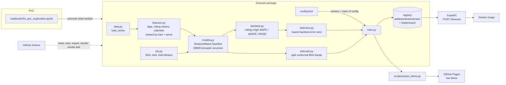

# Forecast: PoC → Production

[](https://github.com/hrutishaa/forecast-poc-to-prod/actions/workflows/ci.yml)
[](LICENSE)

**🔴 Live demo: https://hrutishaa.github.io/forecast-poc-to-prod/** (pick a series, drag the horizon, see which of 5 models the backtest auto-selected, compare it with the baseline against actuals, with an 80% prediction-interval band)

Most forecasting projects stop at a notebook with a nice chart. This repo goes further: it takes that notebook to something you can deploy, with
**a baseline you have to beat → leak-free features → rolling backtests → automatic model selection → prediction intervals → versioned config → model registry → FastAPI `/forecast` → Docker → CI**.

| Series (monthly, 96 pts) | Seasonal-naive MAPE | GBM + lags MAPE | Holt-Winters MAPE | Auto-selected | Error reduction vs baseline |
|---|---|---|---|---|---|
| retail_sales | 4.61% | 1.34% | **0.95%** | Holt-Winters additive | −79% |
| ecommerce_orders | 13.16% | 8.73% | **4.54%** | Holt-Winters additive | −66% |
| energy_demand | 1.95% | 1.94% | **1.54%** | Holt-Winters additive | −21% |

*3-fold rolling-origin backtest, 12-month horizon. These numbers are recomputed in CI.*

### Exponential smoothing + automatic model selection (v0.3)

`forecast/ets.py` adds three exponential-smoothing models, written from scratch (numpy recursions + `scipy.optimize`, no stats library):
**simple (SES)** = level only, **Holt** = level + linear trend, **Holt-Winters additive** = level + trend + additive 12-month season.
The smoothing weights (α, β, γ) are fitted by minimising one-step-ahead squared error inside (0, 1), starting from the best point of a
small grid, so every fit is deterministic. Unit tests check that Holt reproduces a straight line exactly and Holt-Winters recovers a
known trend + season exactly.

`forecast/selection.py` then gives **all five candidates the same rolling backtest and ships the lowest-error one per series**
(`[model] name = "auto"` in `config.toml`; rank by MAPE, sMAPE or RMSE; ties go to the simpler model). The full leaderboard is saved
in the registry with the model and served at `GET /models/{series}`:

| Rank (by MAPE) | retail_sales | ecommerce_orders | energy_demand |
|---|---|---|---|
| 1 | **Holt-Winters 0.95%** | **Holt-Winters 4.54%** | **Holt-Winters 1.54%** |
| 2 | GBM + lags 1.34% | GBM + lags 8.73% | GBM + lags 1.94% |
| 3 | ETS simple 3.70% | Seasonal naive 13.16% | Seasonal naive 1.95% |
| 4 | Seasonal naive 4.61% | ETS simple 22.58% | ETS simple 4.23% |
| 5 | ETS Holt 9.13% | ETS Holt 23.89% | ETS Holt 4.58% |

What the numbers say, honestly:
- **Holt-Winters wins all three series.** The data really is trend + season + noise, which is exactly what Holt-Winters models. sMAPE gives the same winner (0.94%, 4.55%, 1.54%).
- **Models without a season lose badly.** SES and Holt can't see the November/December peaks. Holt is worst, because it extends whatever slope the last peak or dip left behind.
- **Selection also holds up on unseen months.** In the demo, selection runs on the training window only, and the selected model is still the best one on the 12-month holdout for every series (retail 1.20% vs 1.85% for GBM, e-commerce 5.08% vs 11.99% for the baseline, energy 1.71% vs 1.97%).
- **It fixes the v0.2 interval miss on e-commerce.** The Holt-Winters 80% band covers 9/12 holdout months (GBM: 4/12), at ±7.8% average width (GBM: ±9.4%). Retail is 12/12 at ±3.2% and energy is 11/12 at ±4.7%.
- **Cross-check:** on the same backtest, `statsmodels`' Holt-Winters (heuristic init) scores 1.02% / 5.21% / 1.43%, against 0.95% / 4.54% / 1.54% for this implementation. That's close enough to trust the from-scratch version (statsmodels is used only for this check and isn't a dependency).
- On this synthetic data, e-commerce has *multiplicative* seasonality, so a multiplicative Holt-Winters variant is the obvious next candidate.

### Prediction intervals (v0.2)

A single number is not enough for planning, so every forecast now comes with an **80% prediction interval** built with
**split conformal calibration** (`forecast/intervals.py`): re-fit the model at 12 past cut-offs, measure its real relative
error at each step ahead, and use the finite-sample conformal quantile of those errors as the band's half-width. No extra
model and no normal-distribution assumption, and the band widens the further out you forecast.

Honest check on the demo's 12-month holdout for the v0.2 GBM model (band calibrated on the training window only; see v0.3 above for the auto-selected model):

| Series | GBM band coverage (target 80%) | Avg. band width |
|---|---|---|
| retail_sales | 12/12 = 100% | ±7.2% |
| energy_demand | 9/12 = 75% | ±4.6% |
| ecommerce_orders | 4/12 = 33% | ±9.4% |

The e-commerce miss is a real finding, not a bug: on a fast, exponentially growing series the recursive GBM's errors on
unseen months are bigger than its past errors, so the band is too narrow. That is exactly what intervals plus a coverage
check are for, and it is the motivation for the drift-monitoring item on the roadmap. (In v0.3 the auto-selected Holt-Winters model
covers 9/12 on the same months.)

## Architecture



### Design decisions
- **Baseline first.** Seasonal naive gets the same backtest as every candidate model. If the model doesn't beat it, the model doesn't ship (`beats_baseline` is saved in the model's metadata).
- **No train/serve skew.** Training and recursive inference both call the same `make_features`, and a unit test checks that no feature can see the value it's predicting.
- **Selection by backtest, not by taste.** Every candidate gets the same folds and the winner is chosen by error, per series. A simple classical model winning against GBM is a result worth shipping, not hiding.
- **Trees can't extrapolate trends,** so the GBM learns *first differences* and the predictions are added back up to levels.
- **Intervals from real errors.** Bands come from out-of-sample errors per step ahead (split conformal), are stored with the model in the registry, and refuse to claim a level the calibration data can't support (e.g. 95% from 10 errors raises an error).
- **Versioning by config hash.** `ets_hw_add-705b00b4ca` means "this exact config". Retraining with the same config overwrites the same version, and any config change creates a new version alongside the old one, which makes rollback easy.
- **Free, instant demo.** The static page reads results that the pipeline precomputed (`docs/data.json`), so there are no servers or keys to keep running.

## Quickstart

```bash
git clone https://github.com/hrutishaa/forecast-poc-to-prod && cd forecast-poc-to-prod
python -m venv .venv && source .venv/bin/activate      # Windows: .venv\Scripts\activate
pip install -e ".[dev]"
pytest                                                  # 43 tests
python -m forecast.selection                            # print the backtest leaderboard per series
python -m forecast.train                                # select + backtest + register all series
python -m forecast.train --model gbm_lags               # or pin one model instead of "auto"
uvicorn forecast.api:app --reload                       # http://localhost:8000/docs
```

```bash
curl -X POST localhost:8000/forecast -H 'Content-Type: application/json' \
  -d '{"series": "retail_sales", "horizon": 12}'                    # model defaults to "auto"
curl localhost:8000/models/retail_sales                             # selection leaderboard
```

With Docker:

```bash
docker build -t forecast . && docker run -p 8000:8000 forecast
```

## API

| Method | Path | Description |
|---|---|---|
| GET | `/health` | liveness + app version |
| GET | `/series` | available series |
| GET | `/models/{series}` | model-selection leaderboard (MAPE, sMAPE, RMSE per candidate) and the winner |
| POST | `/forecast` | `{"series": str, "horizon": 1..24, "model": "auto" \| "seasonal_naive" \| "gbm_lags" \| "ets_simple" \| "ets_holt" \| "ets_hw_add"}` → dated forecast with `lower`/`upper` 80% interval + `interval_level` + `model` + `model_version` |

## Project layout

```
forecast/      config, data, features, models, ets, backtest, selection, intervals, registry, train, api
tests/         43 pytest tests (leakage, metrics, models, ETS, selection, intervals, registry, API, demo export)
notebooks/     the original PoC notebook (the "before" picture)
scripts/       export_demo.py → docs/data.json
docs/          static live demo (GitHub Pages)
config.toml    the one place to change model hyperparameters
```

The sample data is synthetic: seeded trend, seasonality and noise, so every result can be reproduced. To use real data, replace `load_series` with a warehouse query.

See [ROADMAP.md](ROADMAP.md) for what's next and [CHANGELOG.md](CHANGELOG.md) for what changed.

## License

MIT © 2026 Hrutishaa Nanduti
